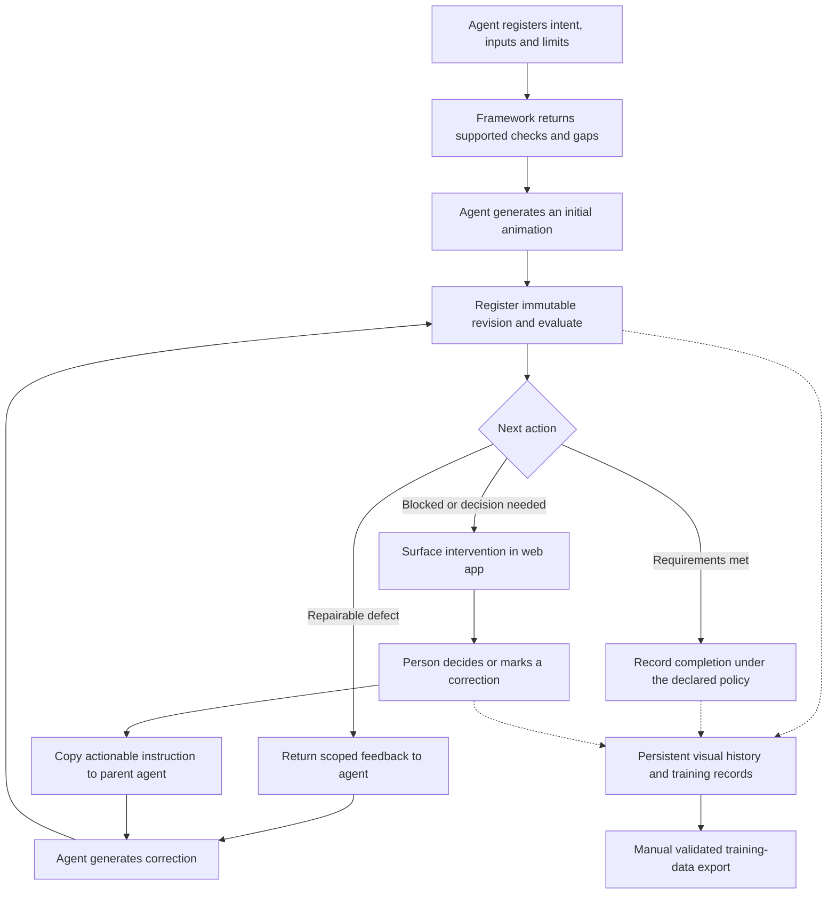

# Agent-led animation workflow plan

Status: proposed implementation plan, 2026-10-30. This document records the target product and the work needed to reach it; it does not claim these changes are implemented. It supersedes reference-first and mandatory-review assumptions as the product direction. Existing capability documentation still describes the running software.

## Implementation progress

The task-registration foundation is implemented in the additive v3 service; see
[Agent task registration](AGENT_TASKS.md) for the public CLI/MCP/HTTP operations,
backup behaviour and exact capability boundary. This establishes immutable
reference-free intent and generation-input compilation. The [external-agent loop](AGENT_LOOP.md) now provides declared-region evaluation,
localized fail/repair/pass feedback, immutable submissions, persistent stopping
limits and separate automatic output eligibility. Its controlled procedural
benchmark does not claim arbitrary generated-art quality. Saved reviewer corrections, exact decisions and shared stale-aware handoff rendering
are implemented in the same loop. The live workspace now displays packet-free runs, candidate-first film, current/best
revision history, exact event navigation, saved markup and copy/download handoffs.
Portable v3 training snapshots now extend the existing atomic publisher, with
separate human/automatic label views, correction trajectories, optional-input
closure, moved validation and manual preview/publication. Optional known-good enhancement/interpolation now binds explicit designation,
protected source keys, authored-time correspondence, mapped playback and portable
source lineage. A provisional tracked-scene milestone now measures declared camera-compensated
landmarks, visibility and interaction events, with an offline benchmark runner
reporting errors/localization and actual label provenance. Independently reviewed
generated-art validation and the final requirement-by-requirement audit remain open.

## Goal

Framebound helps an external agent produce accurate, complex image-generated animations through repeated, evidence-based correction. The agent generates the art, calls the framework, receives actionable feedback, corrects the animation and submits a new revision. Framebound checks the result, records the process and returns the next action until the declared requirements are met or the run reaches an explicit stopping condition.

The web app visually documents that process. A person can inspect progress, export the accumulated training data and occasionally make a decision or mark a defect. A manual intervention must produce a concise, copyable instruction that lets the person continue work in whichever parent agent they are using.

An existing reference animation is optional. The default workflow must work without one.

## Product decisions

1. **The external agent owns generation and iteration.** Framebound is its checking, feedback and evidence layer. The browser is not required to keep a run moving.
2. **Start from intent and available inputs.** A task may have a description, character/style images, keyframes or a known-good animation. Do not require a completed reference animation or one reference drawing per generated frame.
3. **Feedback must support a correction.** Report the defect, affected frames/times/regions, evidence, desired outcome, preservation rules and how the next revision will be checked. A generic “failed” result is insufficient.
4. **Human review is exceptional.** Missing an optional reference or finishing a normal iteration does not create a mandatory review task. Escalate a concrete unresolved choice, blocker or explicit review request.
5. **Evidence and acceptance remain distinct.** Passing supported checks is not proof of artistic quality. Parent-agent completion and human acceptance must have separate, truthful labels.
6. **Every iteration contributes records.** Keep failures, attempted fixes, outcomes and manual interventions. Export them with their actual evidence and label source; do not turn automatic success into invented human preference data.
7. **Keep the established visual direction.** Evolve the current PostHog-inspired workspace and film interaction around this workflow. Do not restart with unrelated design candidates or add explanatory filler to the interface.

## The end-to-end loop



An agent can also retrieve a saved intervention directly through MCP/CLI instead of receiving pasted text. Copying a prompt is a bridge for the user's existing agent, not a second source of instructions or a requirement to connect a chat account.

### 1. Register the task

Persist an immutable task specification containing:

- Intended action, subjects, appearance requirements, scene/camera assumptions and relevant interaction constraints.
- Native output dimensions, timing, loop/terminal behaviour and delivery requirements.
- Available identity/style images, keyframes, masks, optional known-good animation and their provenance. No input role implies human approval by default.
- Requirements to preserve, allowed changes and permitted repair scope. For an existing animation, include the exact enhancement or interpolation goal.
- Evaluation profile, required checks, advisory checks and known capability gaps.
- Iteration/compute/provider limits, completion policy and intervention policy.

The framework negotiates applicability before generation: what it can measure, what needs additional evidence, and what it cannot currently establish. Freeze the resulting requirements and policy for that run. An agent cannot make a failure disappear by weakening a threshold, dropping a check or reclassifying it mid-run; changing the task creates a new specification revision with a recorded reason.

No-reference operation does not mean no specification. If the task begins with prose alone, record any agent-proposed design anchors as proposals with their actual provenance. They can stabilize later conditioning without becoming a known-good motion reference. If an essential requirement cannot be evaluated, return the specific limitation and available ways forward rather than require a fictional guide.

### 2. Generate and submit

The parent agent uses its own image-generation tools or an explicitly configured provider adapter. It imports the resulting frames, authored timing and generation metadata, then registers a revision. Each submission identifies its parent, task specification, targeted feedback and changed assets. Unchanged assets are reused by identity.

Initial generation must not depend on a reviewer approving per-phase drawings. Provider spending still needs the user's configured permission and limits, separate from artistic review. Existing scoped provider jobs remain an optional execution route rather than the only way an agent can supply pixels.

### 3. Evaluate and return feedback

Evaluate the complete revision against the frozen requirements, including relevant neighbours, loop seams and transitions. Persist the exact inputs and evaluator identity. The response gives a prioritized set of correction tasks, not just raw metrics.

Group related symptoms when they have a common repair scope, while preserving their individual check results. Distinguish a candidate defect from a tool failure or missing measurement. An unreadable asset needs re-import or tool recovery, not a prompt to redraw its anatomy.

### 4. Correct and re-evaluate

The parent agent consumes the feedback and creates a child revision. Framebound verifies declared edit scope and rechecks the full required matrix. Improvement at the target must not conceal regressions elsewhere. Failed attempts remain in history; the current best revision is retained separately from the latest attempt.

Some defects require redrawing a transition or a larger sequence rather than one frame. The task must state that scope explicitly. The framework must not silently widen it. A new request for broader scope can be negotiated under the task's existing policy or escalated if outside it.

### 5. Finish or stop honestly

A run stops when its requirements and completion policy are satisfied, when it is cancelled, or when a concrete blocker prevents further useful work. Persist attempt limits, no-progress signatures, repeated regression/oscillation and provider failures across restarts. Do not promise that unrestricted retries will eventually produce a good animation.

Completion reports state what was verified and what remains a judgment. The parent agent may record that the output satisfies the creative request, but this remains agent judgment. A person can approve or reject an exact revision when needed; ordinary technical completion does not wait in a human approval queue.

No profile can claim animation accuracy merely because files decode and durations match. Define a minimum required quality matrix for each supported profile before a run starts. Structural-only evaluation remains useful, but its completion label must explicitly say that animation quality was not verified.

## References, comparisons and interpolation

These roles must be distinct in storage, feedback, exports and UI:

| Role | Meaning | Behaviour |
|---|---|---|
| Identity/style input | Appearance conditioning or a declared design anchor | Available in contextual inputs; not a reference animation or proof of correct motion. |
| Optional motion/keyframe input | Partial pose or motion guidance | Declare which times/requirements it covers. Do not imply authority over uncovered intervals. |
| Known-good animation | An explicitly designated animation being enhanced, detailed or made more fluid | Preserve the specified properties and compare using an explicit time correspondence. Record who designated it and on what basis. |
| Previous revision | The parent or another selected attempt | Useful for seeing changes; never label it “Reference” or promote it to ground truth automatically. |
| Current candidate | The revision being evaluated or inspected | Main film and playback content. |

For a reference-free task, show the candidate and its check track. Do not reserve an empty reference lane, duplicate the candidate into it, or insert a missing-reference warning for an input the task does not require. “Compare” can reveal a previous revision or an optional input when one exists.

For added frames, freeze source timing/keyframe anchors and persist a source-to-output time map. New frames need correspondence by authored time or declared motion interval, not array index. Preserve duration, contacts, key poses and camera behaviour as specified; adding frames alone is not proof of greater fluidity. New timing or changed key poses require a new task/contract revision. Detail enhancement may legitimately change palette, area or texture, so those measurements cannot blindly require pixel similarity to the source.

The existing approved-guide/native-sprite path remains a specialized profile. Its exact phase comparisons and protected restoration still require their actual reference inputs. Making references optional elsewhere must not cause that path to fabricate replacements or silently lose its checks.

## Evaluation without a completed reference

Removing the reference lane is a UI change; supporting reference-free work is a framework change. Each check needs declared prerequisites, applicability, evidence source, limits and a response when it cannot be measured.

| Evaluation family | Possible basis without a reference animation | Limits and response |
|---|---|---|
| Media and timing | Actual dimensions, decodability, frame ordering, holds, expected duration and loop/terminal rules | Deterministic checks can establish structural validity, not movement quality. |
| Edit preservation | Exact parent pixels outside allowed edit support; frozen keyframes and declared timing anchors | A parent is a preservation baseline for a scoped edit, not proof that its motion was correct. Full initial generation needs no such baseline. |
| Identity and appearance | Supplied design inputs, declared visible features, tracked subject regions and explicitly defined tolerances | Whole-image palette or silhouette statistics cannot establish anatomy or identity across arbitrary poses/cameras. Report visibility and method limits. |
| Temporal consistency | Neighbouring frames, tracks, declared camera/root motion, contact intervals, loop boundaries and supplied annotations | Real motion changes shape. Distinguish intended motion from unexplained discontinuity; do not treat cycle median or pixel difference as universal ground truth. |
| Action and scene correctness | Task-specific constraints, key events and, when enabled, structured visual assessment with localized evidence | Complex action, occlusion and object interaction exceed the current raster checks. Model assessment is fallible, versioned evidence, not a deterministic fact or human decision. |
| Optional source fidelity | Known-good animation plus an explicit time/pose correspondence and preservation rules | Applies only when that source exists. Inserted frames cannot claim same-frame source comparison where none exists. |

Keep outcome (`pass`, `fail`, `unmeasured`, `error`, `not_applicable`) separate from evidence method and confidence. Omitted optional checks are different from required checks that could not run. Missing required evidence blocks a “requirements met” claim; it can lead to an agent obtaining annotations, a supported alternative, a revised task or a specific intervention. It does not automatically require human inspection of every frame.

Complex image-generated animation is the product goal. The current fixed-canvas native-sprite engine is the first supported profile, not evidence that arbitrary perspective changes, occlusions, multiple subjects or interaction physics are already solved. Broader profiles need their own datasets, counterexamples and measured capabilities. Optional segmentation/tracking or model-based assessors must retain their provenance and uncertainty, independently verify measurable claims where possible, and work within configured budgets. Do not add an unbounded internal agent that competes with the parent agent.

### First reference-free quality profile

Start with a fixed-canvas, single-subject animation with controlled view, declared action/timing and available appearance inputs. It must not need an existing motion cycle. Build a defect suite before choosing thresholds: disappearance/duplication of a visible feature, flicker within a tracked costume region, an unexpected discontinuity, an incorrect declared contact, an obvious unintended repeated drawing during a moving interval, and a broken loop. Include correct examples with legitimate pose changes, holds, deformation and occlusion so a repair loop does not destroy intended motion.

For each defect, specify the actual method and prerequisites. Registration/timing can reuse deterministic checks; feature/contact measurements need usable regions, tracks or annotations. Optional model proposals may supply those inputs, but their uncertainty and dependencies must remain visible and must not validate themselves merely by asserting success. Appearance drift must be evaluated in corresponding regions, not by requiring an arbitrary whole-frame palette or silhouette match.

When methods cannot reliably localize a defect, mark that capability as advisory/unsupported rather than claim a completed quality check. Measure false alarms, missed defects, frame/region localization and whether repairs based on the feedback improve independently labeled examples without new faults. Freeze evidence-backed acceptance thresholds per profile; do not invent universal scores in advance. This profile and its benchmark are part of the first working agent loop, not a later UI enhancement.

Expand next to camera/scale changes, occlusion and multiple interacting subjects as separate capability milestones. Include task/event correctness as well as visual consistency: a perfectly consistent animation of the wrong action is still wrong. Track test-case coverage and evaluator limitations independently of run completion.

## Feedback and parent-agent handoff

### One durable feedback object

Introduce a versioned feedback bundle generated by a shared service, consumed by MCP, CLI, HTTP and the web app. Proposed records and operation names in this plan are design targets, not existing API promises.

The bundle contains:

- **Identity:** project, animation, run, task specification, baseline revision, evaluation, evidence digest and bundle version.
- **Disposition:** continue, complete, blocked, awaiting input or awaiting decision, with the concrete reason and best/current revision identities.
- **Targets:** stable issue/task IDs, priority, observation source, frame IDs/display numbers, half-open tick ranges, native coordinate space and ROI/mask when available.
- **Evidence:** actual versus expected measurements, overlays/crops/adjacent frames, uncertainty and any missing prerequisites. Use resolvable asset IDs and hashes; do not rely on filenames or signed URLs alone.
- **Correction:** desired result, relevant generation inputs, suggested operation or regeneration scope, protected content, unchanged timing and other preservation requirements.
- **Verification:** checks to rerun, allowed regression limits, submission binding and remaining attempt/compute budget.
- **Continuation:** actual available tool operations and required arguments, or a portable manifest/import route for an agent without the MCP connection.

An instruction must be actionable without claiming a unique pixel-perfect solution when the evidence only identifies a problem. For example, ask for continuity in a measured feature within a declared interval; do not invent a pose or contact that was never specified.

### Copy interaction

After a person saves a markup or decision, offer **Copy instructions** next to that saved action. The task view and blocked-run view offer the same action. Render concise text from the durable bundle, with an optional structured JSON view. The copied text includes the exact target, requested change, preservation rules, evidence locations, submission and re-evaluation steps. Do not copy unrelated project history, credentials or hidden provider settings.

Use the same rendering service for automated feedback and human handoff so they cannot drift. A markup's free text is user-supplied correction content, not permission to override execution limits. Copying succeeds only after the action is saved, and the UI gives a brief success/failure indication. When copying is unavailable, allow selection/download of the same text.

A handoff is revision-bound. If the parent agent resumes later or in another chat, it first fetches the task/current state and verifies the bundle's target. Stale instructions must produce an explained rebase/new bundle, never a silent edit against a different revision. Pasted text is not an authorization token.

Illustrative rendered instruction (IDs and measurements would come from stored evidence):

```text
Continue animation run RUN in project PROJECT.
Task TASK targets revision REVISION, evaluation EVALUATION.
Fetch the saved task and verify these bindings before editing.

Correct the marked left-hand discontinuity in frames 7–9 (ticks [18, 27)).
Use the task's attached region and evidence crops. Preserve the face,
costume, background, other frames and authored holds. The required outcome
and check bounds are in the saved task; do not change them to obtain a pass.

Submit a child revision linked to TASK and REVISION, then evaluate the full
clip. Continue from the returned feedback within the existing run limits.
If scope or evidence is insufficient, report that blocker instead of
claiming completion.
```

For an unconnected agent, replace the fetch/submission directions with the actual exported task manifest and supported import procedure. Do not present internal IDs as if another machine can resolve them without access to the project.

## Web app

### Information hierarchy

The default view prioritizes **Interventions**, grouped by project. Only real blockers, pending manual corrections, exceptional decisions and explicitly requested reviews belong here. A technically successful unreviewed animation is not automatically an intervention.

**Timeline** shows the entire process in chronological order within each project and animation: initial submission, evaluations, feedback, attempts, selected improvements, failures, intervention responses and completion. Selecting an event loads its exact revision and relevant evidence; the latest state remains clearly distinguishable from the historical event being inspected. Machine and human decisions have visible, different sources.

Within an animation, show the current/best result and a compact revision history. Preserve project grouping and remove dependence on review-packet creation for an ordinary run to appear. No new top-level “Sequences”, project-title menu, pairing option, refresh button or decorative explanatory copy.

### Main workspace

- Candidate film is the primary visual surface. Retain black stock, clear frame apertures, neutral transparency backing, smooth drag/elastic end return and zoom.
- Checks and corrections remain in a separate aligned track, visually attached to the inspected frames without becoming part of the film image or stock. Only show relevant metrics; area/width are not universal measures of quality.
- Compact opaque lane tabs fit their titles and sit flush left, using the existing solid surfaces, thin borders and typography. Add a comparison lane only when requested or appropriate to a real source.
- On opening an animation/revision, select and centre the earliest actionable errant frame. Use chronological frame scope, including temporal issues; fall back to the first frame for a clean clip. A late live update does not steal selection or discard unsaved work.
- Playback has one active main stage. Default to a single candidate; use synchronized source/candidate playback only for an explicit comparison with valid time mapping. The strip camera and inspector do not chase every playback frame. Pause adopts the stopped frame once.
- A contextual inspector shows the selected defect, measurements, evidence, attached instructions and status. It does not duplicate an animated player or continually cycle its controls during playback.
- Keep transport, zoom and actions in consistently spaced groups. Show decision/markup actions when applicable. Export remains easy to find without dominating frame inspection.

### Rare intervention

Select a frame or authored range, mark a native-pixel region if useful, state the desired correction and save. Framebound creates a revision-bound task and offers **Copy instructions** immediately. A spatial mark localizes feedback; its authority to permit edits must be explicit under the run's policy. The person can inspect the returned replacement and resolve/reopen the subjective task.

Manual approve/reject/needs-changes records remain available. They attach to the exact revision/evaluation, preserve any note and generate a continuation instruction when further work is needed. No automatic process can impersonate that reviewer decision. General viewing and normal agent progress do not require a human reference-approval session.

## State, completion and authority

Represent these axes separately rather than use a single green “approved” badge:

| Axis | Examples | Source |
|---|---|---|
| Run lifecycle | Running, awaiting agent, awaiting provider, blocked, completed, cancelled | Durable orchestration state |
| Technical result and coverage | Pass/fail/error/incomplete; complete/partial/unsupported | Actual evaluated requirements |
| Creative completion | Not assessed, agent satisfied, human approved/rejected/needs changes | Explicit recorded actor and evidence |
| Output eligibility | Usable under the task's automatic policy, or human-reviewed release | A named, versioned policy evaluated on the exact revision |
| Training membership | Human-accepted positive, automatically verified, weak/model-labeled, negative/research, withheld | Separate export rules |

Introduce an explicit automatic completion/output policy instead of removing the current human gate from `release_eligibility`. Preserve that existing reviewed-release route for tasks that require it. The default agent-led route may deliver a technically verified result with an unreviewed creative status, or record parent-agent satisfaction, while declaring any capability gaps. A required unresolved check prevents automatic success. An open subjective correction remains unresolved until its configured owner resolves it; technical repair cannot silently close human feedback.

Separate task intent, edit permissions, provider execution grants, source designation and human acceptance. Routine agent work uses configured policy, not fabricated reviewer credentials. Hash binding, immutable lineage, stale-evidence checks, rights/origin tracking, scoped edits, spend controls and durable recovery remain intact. Retrying under a new name must not reset budgets.

### Record and migration boundaries

Use explicit records for the task specification, run, optional input bindings, feedback bundle and completion result. Reuse immutable clip revisions, evaluations, attempts and correction tasks; bind each new object to those exact identities. Feedback references its evaluation and targeted tasks. A handoff references saved feedback, not a transient browser selection. Completion references the task policy, selected revision and evidence, not a mutable status flag.

Introduce the next schema/API version for these semantics and advertise reader capabilities. Never reinterpret stored v2 guide approvals or rewrite old evidence to make it look reference-free. Migrate additively, back up projects, retain the old profile explicitly and provide dry-run migration reports. Existing agents can keep using the reviewed-guide tools while new agents opt into the new task path. Snapshot readers must reject unsupported new label semantics rather than quietly load automatic examples as human positives.

## Training data and manual export

Record the learning trajectory continuously; publish a dataset only when requested. The export screen selects projects/animations/runs, a versioned export policy and destination, then previews counts, label sources, exclusions and validation. It works for runs with no motion guide and no human approval.

Include the original intent and inputs, task-specification versions, ordered candidate revisions, generation metadata when available, evaluation evidence, feedback bundles, targeted tasks, attempted changes, before/after outcomes, timing maps and human interventions. Missing prompts or unavailable provider metadata are recorded as missing rather than invented. Retain rights, origins, derivation family and procedural/simulated labels.

Keep these training views distinct:

- **Human-accepted positives:** preserve current strict eligibility, rights, freshness and exact-decision requirements.
- **Automatically verified examples:** optionally include complete passing examples under a named policy, labeled as technical/agent evidence and unreviewed where applicable. This is a new, separate view, not an expansion of the existing human-positive folder.
- **Correction trajectories:** input/task, failed revision, localized feedback, repair candidate and actual outcome. A repair may improve the target and still fail overall; retain both facts.
- **Preferences:** explicit human comparisons remain separate from automatic technical rankings and model preferences. Do not infer a preference pair merely because a newer revision exists.
- **Research/withheld:** failures, partial coverage, uncertain judgments and restricted origins retain their exact labels/exclusion reasons. Export does not grant training rights.

Extend existing portable snapshots, COCO/imagefolder/temporal formats and validators rather than introduce a disconnected exporter. No-reference snapshots must validate without dummy guide rows. Package the pixels and evidence needed to understand the supervision after moving the snapshot. Keep related revisions, references and near/exact duplicate families together when splitting data to avoid leakage.

## Current implementation: reuse and gaps

This assessment is based on the repository at merge commit `4a93573`.

| Area | Reuse | Required change |
|---|---|---|
| Domain and task creation | `framebound/v2/domain.py`, `services/bootstrap.py`, `services/contracts.py` | Current `PhaseEntry.motion_reference_id` is mandatory and bootstrap directs callers through guide/reviewer setup. Add a versioned task/profile model with optional motion bindings and a public reference-free creation path. |
| Generation briefs and jobs | `services/briefs.py`, `briefs/compiler.py`, `services/jobs.py` | Current compilation requires stored human guide approval and phase pixels. Add a separate intent/input-bound compilation path; retain the approved-guide path and provider send protections. |
| Evaluation | `services/clips.py`, `checks/registry.py`, `checks/evaluate.py`, `checks/implementations.py` | Preserve exact evidence/coverage. Resolve optional inputs explicitly; add prerequisite-aware profiles and feedback normalization. Missing guides currently leave reference-dependent checks unmeasured, not a usable general motion evaluator. |
| Iteration and repair | `services/auto_repair.py`, `services/repair.py`, `services/corrections.py`, `services/orchestrator.py` | Existing bounded execution, immutable attempts and correction tasks are useful. Decouple the ordinary external-agent loop and its limits from mandatory human guide approval; add durable best/current selection and stop reasons. |
| Transport | `mcp/server.py`, `cli_commands.py`, `api/app.py`, `api/dto.py` | Expose the same task, feedback and continuation services in all transports. Return structured next actions without browser-only steps. |
| Acceptance and eligibility | `services/review_state.py`, `services/eligibility.py`, `services/approvals.py` | Keep actual reviewer authority and exact-evaluation binding. Add distinct automatic completion/output policy instead of treating every finished run as awaiting human approval. |
| Browser | `web/src/App.tsx`, `PacketWorkspace.tsx`, `Film.tsx`, `review-model.ts`, `Operations.tsx` | Preserve the visual system and stable playback. Make run history/candidate-only viewing first class, conditionalize comparisons and add saved-action handoff/export flows. |
| Dataset | `framebound/v2/exports/`, `services/evidence.py` | Extend portable closure to optional reference/task/feedback/time-map records and separate label views, preserving current positive/preference rules. |

These are changes to the product model and API, not a stylesheet fix. Hiding the reference row while retaining a guide-dependent generation gate would not satisfy this plan.

## Delivery sequence

Each phase ships in its own branch/PR with migrations, current capability reporting and documentation updated alongside behaviour. Preserve the existing reviewed-guide profile throughout. Complete the reference-free vertical slice before adding broader animation-quality claims.

| Phase | Deliverable | Acceptance gate |
|---|---|---|
| 1. Task and policy model | Versioned task spec, optional input roles, profile negotiation, completion/permission policies and migrations. | Create and reload a task with no motion guide, no per-frame reference IDs and no reviewer decision through public services. Existing approved-guide projects retain their original semantics. |
| 2. Agent-loop vertical slice | First reference-free quality profile/defect suite, initial external submission, complete evaluation, durable actionable feedback, child submission, best/current selection, continuation and bounded stopping. | An external MCP/CLI client completes a reference-free fail → repair → pass journey with localized quality defects, beyond file/timing checks, without opening the browser or fabricating approval. Correct motion counterexamples are retained. Restart/replay does not duplicate work or reset limits. |
| 3. Intervention and handoff | Save markup/decision, feedback-backed text/JSON renderer, copy/download and stale-task handling. | A person marks a real fault; a fresh parent-agent session uses only the handoff plus supported project access to submit a correctly bound correction. Stale instructions cannot overwrite a newer target. |
| 4. Live documentation UI | Run-based intervention queue/history, candidate-first film, optional comparison/time mapping, focused evidence and responsive controls. | Real run events appear automatically; timeline selection opens the recorded revision; first errant frame centres; playback stays stable. A clean unreviewed run does not fill Interventions. |
| 5. Training export | Trajectories, label-source views, optional-input closure, preview counts and moved-snapshot validation. | Export an entirely reference-free run with failures, automatic completion and a separate human correction. Verify all pixels/labels/bindings after moving it; no inferred human positives or preference pairs. |
| 6. Known-good enhancement/interpolation | Explicit source designation, preservation policy, timing correspondence and matched comparison. | Enhance detail and insert frames into a source animation without index-based alignment errors; verify keyframe/timing preservation and record source lineage. |
| 7. Broader complex-animation profiles | Evaluators for the next supported scene/motion class, optional bounded assessors, documented uncertainty and benchmark set. | Demonstrate accurate localized feedback on independent successes and counterexamples for occlusion, camera changes and interactions that the profile claims to handle. Unsupported cases remain explicit. |

Phases 1–5 establish the default product. Phase 6 adds the important optional source workflow. Phase 7 expands quality coverage; until then, the UI and agent responses must state the narrower profile's actual limits. Benchmark discovery for phase 7 can begin earlier, without delaying the reference-free architecture or disguising missing capabilities.

### Required verification

- Public reference-free creation/generation-input compilation, including prose-only tasks with explicit capability gaps and identity/style-only tasks. No silent creation of a reference or reviewer event.
- Deterministic issue localization, expected/observed values, actionable repair scope, full-clip regression detection and retention of a better earlier revision.
- Explicit required-unmeasured/error/not-applicable handling, occlusion, legitimate pose-driven shape changes and rejection of mid-run threshold weakening.
- Bounded retries, unchanged-output loops, alternating regressions, simultaneous submissions, lost provider outcomes and process death/restart. Stale submissions are rejected or explicitly rebased.
- Real browser/API handoff: save range/ROI → copy → external correction → re-evaluate → resolve/reopen; single active playback, stable inspection, first-error centring and no empty reference row.
- Known-good enhancement/interpolation with unequal source/output frame counts and durations, protected keys and loop correspondence.
- Portable dataset closure with no guides, mixed label sources, unresolved corrections, rights exclusions, no false preference pairs and family-safe splits.
- Existing native-guide automatic repair, reviewer boundaries, provider controls and strict human-positive export continue to pass.

Use deterministic procedural fixtures and simulated transports to prove engineering behaviour and counterexamples. Separately validate on actual generated animations and reviewed defect labels before claiming reliable complex-animation feedback. Do not present a fixture passing as evidence that arbitrary creative quality has been solved.

## Definition of done

A parent agent can start from an animation request without a completed reference, receive useful localized feedback, submit successive corrections and reach a truthfully labeled result within persistent limits. A person can follow the process visually, intervene rarely, copy precise instructions back to their agent and export a portable, honestly labeled training dataset. Known-good animation improves the workflow when available and is never a hidden prerequisite.
